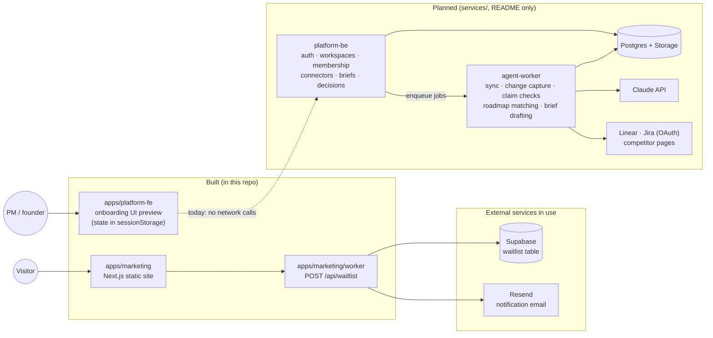

# VerityLoop architecture

Status: living document, last changed 2026-11-21. It describes what exists in this repository and what is only **planned**. Planned parts come from the proposed v1 plan (branch `docs/v1-onboarding-plan`, not merged) and are not decisions until the founders approve them.

## What VerityLoop does

VerityLoop is an AI product-decision system. It has two journeys that share one evidence engine:

- **Opportunity Discovery (founders).** An idea becomes an Opportunity Brief: alternatives, problem evidence, assumptions ranked by risk, and validation tests.
- **Roadmap Impact (product teams).** A market change, checked against the team's roadmap and context, becomes a Roadmap Impact Brief: act, investigate, watch, or ignore.

Both follow one loop: **signal or question → context and evidence → options and unknowns → human decision → next action → new evidence.** A human makes every decision. PRDs, tickets and publishing each need their own approval. Product direction: [verityloop-positioning-and-mvp.md](verityloop-positioning-and-mvp.md) and [PRODUCT.md](../PRODUCT.md).

## System diagram

Solid boxes in **Built** run today. Everything in **Planned** is unbuilt, and `platform-fe` makes no calls to it.

## Components

| Component | Path | Status | Owns | Deploys to |
| --- | --- | --- | --- | --- |
| Marketing site | `apps/marketing/src` | Built | Landing page, SEO, brand assets, illustrative product scenes | Cloudflare Workers static assets (root `wrangler.jsonc`) |
| Waitlist API | `apps/marketing/worker/index.ts` | Built | Validates signups, inserts into Supabase `waitlist` (`on_conflict=email`), sends team notification and welcome emails through Resend | Same Worker as the site, `/api/*` routed to the Worker first |
| Platform frontend | `apps/platform-fe` | Built, as a **frontend preview** | Sign-up, account dashboard, workspace directory, create workspace, invites, connections, documents | Not deployed; no host chosen |
| Platform backend | `services/platform-be` | Planned | Identity, org/domain ownership, server-side membership, invites, OAuth connectors, storage, briefs, decisions | Undecided (plan D2) |
| Agent worker | `services/agent-worker` | Planned | Durable evidence jobs and brief drafting | Undecided (plan: Inngest) |
| Shared packages | `packages/` | None yet | Future contracts, UI, config shared by more than one consumer | n/a |

## Feature breakdown

| Feature | Journey | Where it lives today | Next owner |
| --- | --- | --- | --- |
| Waitlist signup with audience and campaign tag | Both | `apps/marketing` Waitlist + Worker | `apps/marketing` |
| Account and workspace onboarding | Both | `apps/platform-fe/src/features/onboarding` (simulated) | `platform-fe` UI + `platform-be` API |
| Workspace roles: Owner, Editor, Reviewer | Both | `model.ts` `canOpen` / `canManage` (UI only) | `platform-be` |
| Tracker connectors (Linear, Jira; Confluence in preview) | Roadmap Impact | Simulated source picker | `platform-be` OAuth + `agent-worker` sync |
| Product documents | Both | Filename, size and type only | `platform-be` storage + `agent-worker` ingestion |
| Start screen that routes a website vs an idea | Both | Not built | `platform-fe` |
| Change capture, claim extraction, Not verified state | Roadmap Impact | Not built | `agent-worker` |
| Roadmap matching and Roadmap Impact Brief | Roadmap Impact | Not built | `agent-worker` + `platform-fe` |
| Clarify, framing, landscape, Opportunity Brief | Discovery | Not built | `agent-worker` + `platform-fe` |
| Decision record, feedback, Markdown export | Both | Not built (marketing scenes illustrate it) | `platform-be` + `platform-fe` |

## Key flows

**Waitlist (built).** Form → `POST /api/waitlist` → normalize name, email, audience and campaign → Supabase insert (a duplicate email returns success with no email sent) → for new rows, a Resend notification to the team (a failure returns 502), then a welcome email to the signup (a failure is logged and does not fail the request) → JSON response. Tests: `apps/marketing/tests/waitlist-worker.test.ts`.

**Onboarding (preview).** Email → `profileForEmail` assigns a company or personal organization from the domain → dashboard → create workspace (you become its Owner) → optional invites → at least one scoped connection → optional documents → `stage: complete`. All of this state lives in `sessionStorage` key `verityloop-product-preview-v1`. Spec: [design/pm-onboarding.md](design/pm-onboarding.md). Tests: `apps/platform-fe/tests/onboarding.spec.ts`.

**Brief generation (planned).** See [services/agent-worker](../services/agent-worker/README.md).

## Where else to look

| Question | Document |
| --- | --- |
| Why apps, services and packages are split this way; Cloudflare build settings | [monorepo.md](monorepo.md) |
| Proposed v1 scope, stack decisions D1–D5, P0 list | `docs/plans/v1-onboarding-and-first-brief.md` on branch `docs/v1-onboarding-plan` |
| Full requirements (PRD v0.4, written under the earlier Groundtruth name) | Google Doc linked from [PRODUCT.md](../PRODUCT.md) |
| Marketing visual system | [DESIGN.md](../DESIGN.md) |
